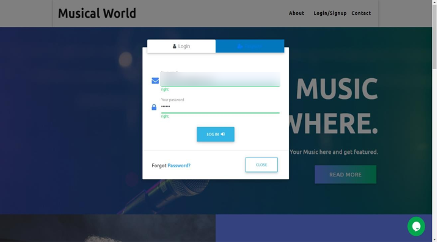
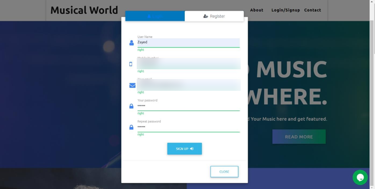
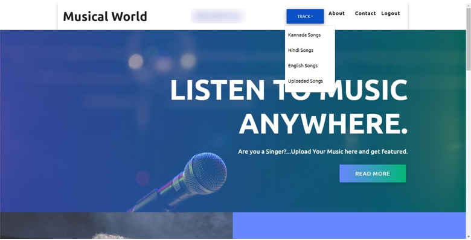
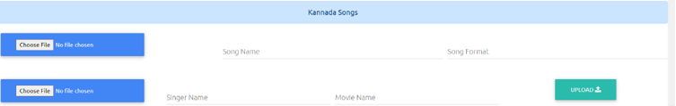
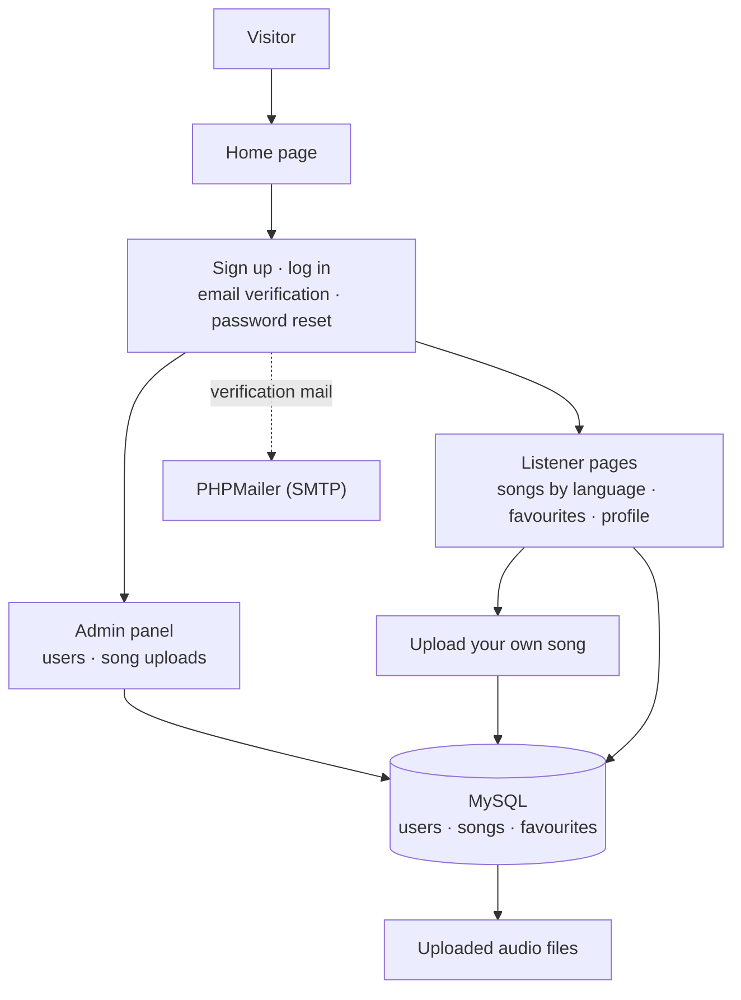

# MusicalWorld: Music Sharing Website

A PHP and MySQL website where independent singers upload their own songs and listeners stream them by language, with accounts, email verification, favourites and an admin panel.

> **Note:** The source code is private. This repository documents the features and design. I'm happy to walk through the implementation in an interview.

---

## Overview

Big streaming platforms make it hard for a new, independent singer to get heard. MusicalWorld lets anyone with an account upload their own songs and share them, while listeners browse music by language, play it in the browser and keep a list of favourites. An admin panel manages users and the song catalogue.

## Key Features

- **Accounts:** sign up with email verification, log in, reset a forgotten password, edit your profile or delete your account.
- **Songs by language:** Kannada, Hindi and English collections, plus a section for songs uploaded by users.
- **Upload your own music:** listeners can upload songs with their name, singer and film details.
- **Favourites:** save songs to a personal list.
- **In-browser playback:** every track plays straight from the page.
- **Admin panel:** see all users and their contributions, and upload songs to each language collection.

## Screenshots

| | |
|---|---|
|  |  |
| *Log in* | *Sign up (personal details blurred)* |
|  |  |
| *Signed-in home page with the language menu* | *Admin panel: uploading a song* |

## Architecture

## How It Works

1. A visitor signs up and confirms their email address through a verification link.
2. After logging in, they browse songs by language and play them in the browser.
3. They can upload their own songs, which are stored as audio files with their details in MySQL.
4. Favourites are saved per user, so each listener keeps their own list.
5. The admin sees every user and their number of contributions, and can add songs to any collection.

## Tech Stack

| Category | Tools |
|---|---|
| Backend | PHP, MySQL (seven tables: users, categories, three language collections, user uploads, favourites) |
| Email | PHPMailer over SMTP for verification and password reset |
| Frontend | HTML, CSS, JavaScript, Bootstrap, jQuery, Font Awesome |

## My Role

I built MusicalWorld on my own: the database design, the PHP pages for accounts, uploads, favourites and administration, email verification, and the front end.

## Contact

**Zayed Makandar** | [zayedmakandar03@gmail.com](mailto:zayedmakandar03@gmail.com) | [LinkedIn](https://www.linkedin.com/in/zayed-makandar-642536422/) | [Portfolio](https://zayedmakandar.com)
